<div align="center">

# ✻ Claudimon

**A cosy creature-collecting sanctuary that lives in your terminal.**

Befriend Claudimon, tend a garden that grows while you're away, battle your way
through The Benchmark, and follow the old verses to the dragon who dreamed the first story.

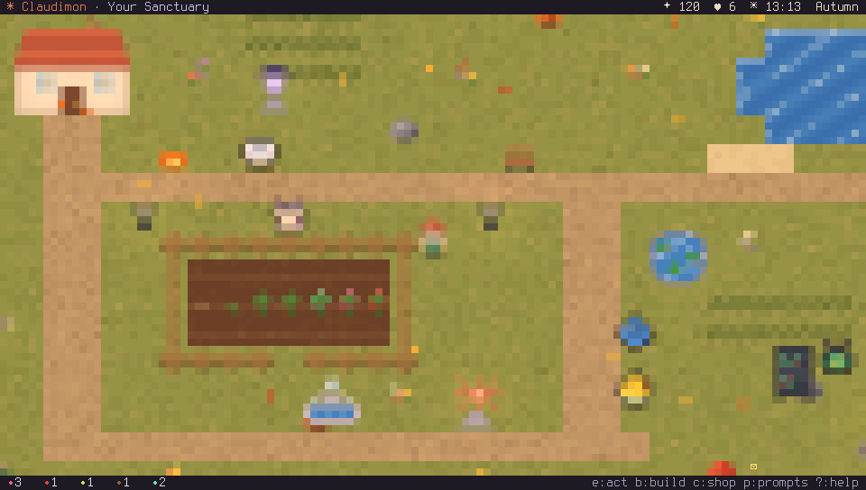

[](LICENSE)
[](https://www.rust-lang.org)
[](#requirements)
[](#arch-linux)

*Made for the minutes in between: while it compiles, while the tests run, while the coffee brews.*

</div>

---

## Contents

- [What is Claudimon?](#what-is-claudimon)
- [Screenshots](#screenshots)
- [Features](#features)
- [Installation](#installation)
- [Getting started](#getting-started)
- [Controls](#controls)
- [Command line](#command-line)
- [Save data](#save-data)
- [The main quest (spoiler-light)](#the-main-quest)
- [Development](#development)
- [License](#license)

## What is Claudimon?

Claudimon is a Pokémon-meets-Animal-Crossing game rendered entirely in the terminal using
half-block pixel art and true colour. Each terminal cell holds two pixels, so the world is
real pixel art with smooth day/night lighting, seasons and weather — no images, no GUI.

There is no game over and no rush. Your **Sanctuary** keeps living on the real clock:
crops ripen, visitors drop by and tip, and happy creatures leave you gifts and slowly
train themselves while you're away. Pop in for two minutes between builds, collect, plant,
pat a Haikitten, and get back to work. Or settle in for an evening and chase the legend
of **Mythos**.

## Screenshots

<table>
<tr>
<td width="50%">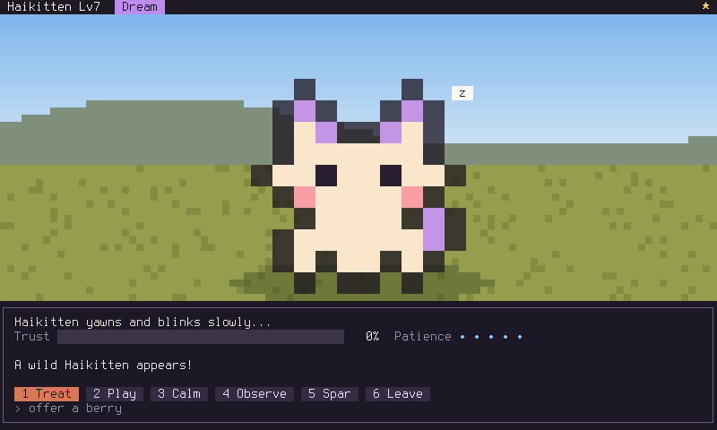<br><sub><b>Befriending</b> — read a creature's mood and respond with the right treat, game or quiet moment.</sub></td>
<td width="50%">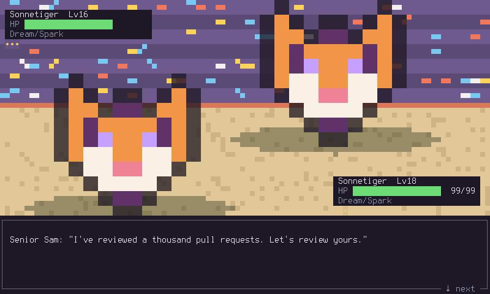<br><sub><b>Battles</b> — friendly spars and the Haiku, Sonnet and Opus cups at The Benchmark.</sub></td>
</tr>
<tr>
<td>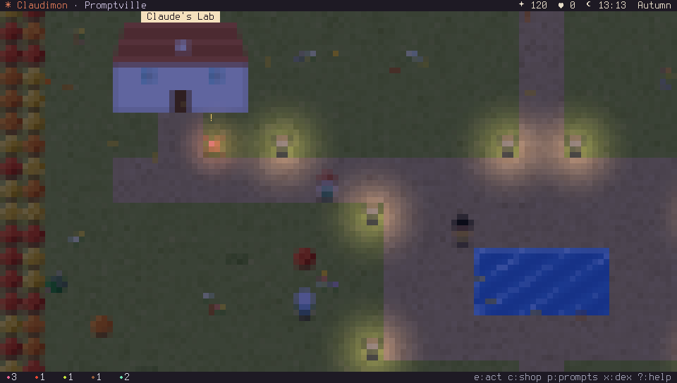<br><sub><b>Promptville</b> at night: Claude's Lab, the Curio Shop and the arena.</sub></td>
<td>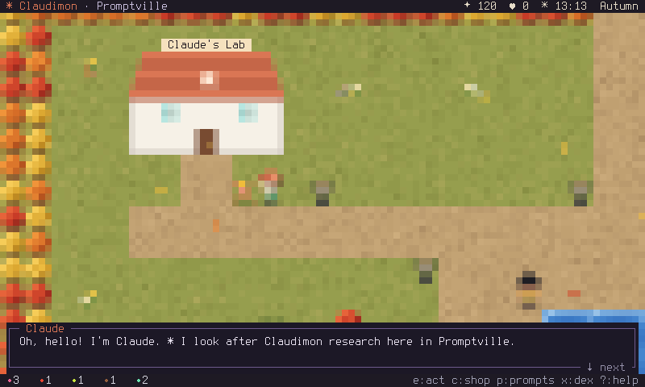<br><sub><b>Claude</b> hands out daily prompts — and has something on their mind.</sub></td>
</tr>
<tr>
<td>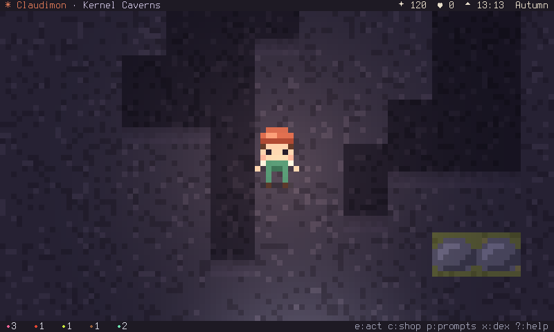<br><sub><b>Kernel Caverns</b> — bring your lantern; crystals and lava light the way.</sub></td>
<td>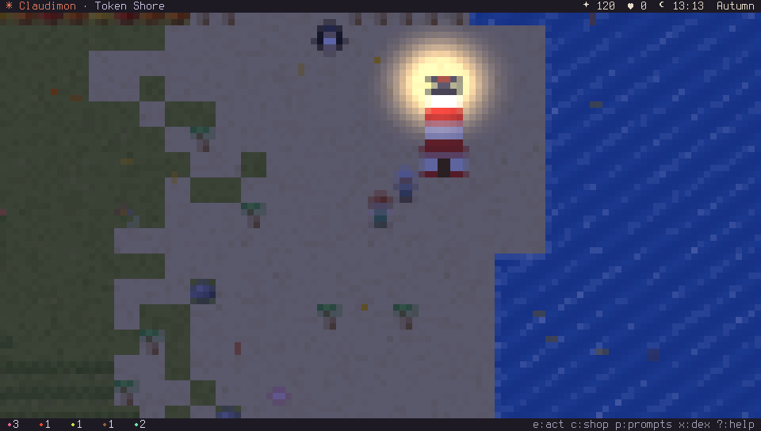<br><sub><b>Token Shore</b> — the old lighthouse, dark for years… until now.</sub></td>
</tr>
<tr>
<td>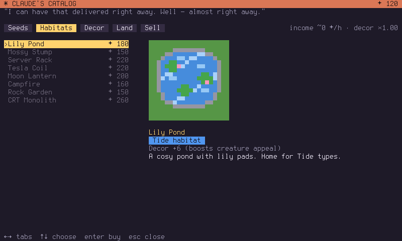<br><sub><b>Claude's Catalog</b> — seeds, habitats, decor and land.</sub></td>
<td>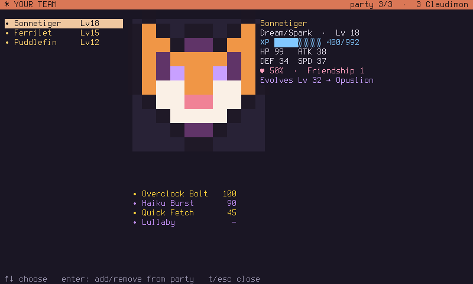<br><sub><b>Your team</b> — levels, stats, moves and evolutions.</sub></td>
</tr>
<tr>
<td>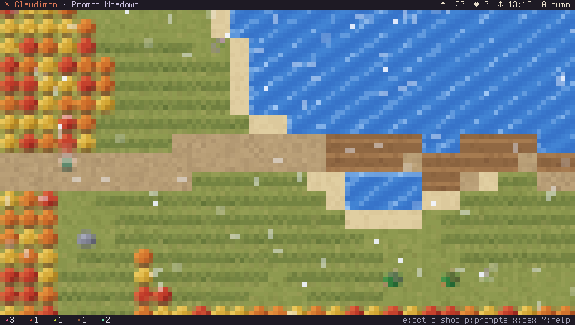<br><sub><b>Weather & seasons</b> — rain waters your crops; winter brings snow.</sub></td>
<td>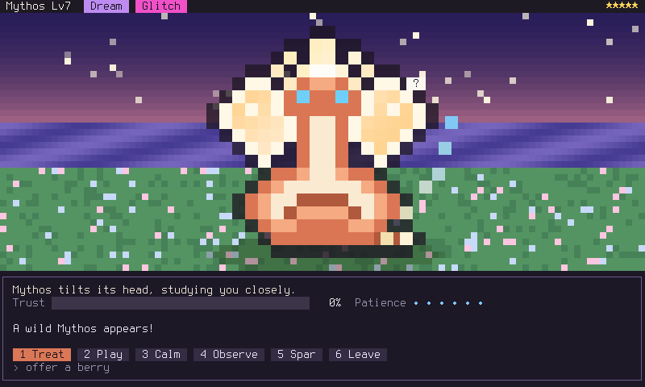<br><sub><b>Mythos</b> — the dragon who dreamed the first story.</sub></td>
</tr>
</table>

## Features

**🌱 A sanctuary that grows while you're away**
- Plant five berry flavours that ripen in real time (rain waters them for you).
- Eight habitats — one per type — plus lamps, fountains, statues and more, placed in build mode.
- Visitors walk in, admire your creatures and tip tokens. Income keeps flowing offline (capped at 12 h, so short check-ins pay best).
- Happy creatures leave gifts and gain XP just by resting at home.
- Expand your land three times, clearing the forest around your plot.

**🐾 41 Claudimon to befriend**
- Haikitten, Tokenling, Gitcko, Bugbyte, Rubberduck, Contextopus, Ferrilet (yes, *that* crab), Segfaultle, Panicorn and many more — each with a favourite flavour, a temperament and a Claudidex entry.
- Evolutions like **Haikitten → Sonnetiger → Opuslion** and **Bugbyte → Featurefly** ("it's not a bug…").
- Rare *Constitutional* shinies (1 in 128) with their own palette and sparkles.

**⚔️ Gentle befriending, real battles**
- Every wild creature shows a mood — its *prompt*. Treat, play a timing game, sit calmly, observe, or spar.
- Turn-based battles with 8 types, 26 moves, stat changes, priority, drain and recoil.
- **The Benchmark**: three cups of trainer battles, ending with Champion Claude.

**🗺️ A world to roam**
- Prompt Meadows, the Latent Woods (fireflies at night), Token Shore, the Kernel Caverns and the town of Promptville — plus an island you'll have to earn.
- Day and night follow your system clock; seasons follow the calendar; weather changes every few hours.

**🎵 Music and sound**
- An original chiptune soundtrack — cosy days, quiet nights, a bouncy town, echoing caves, a driving battle theme and a magical island — all synthesised in code, no audio files.
- Sound effects for picking, coins, hearts, hits, level-ups and evolutions.
- Both can be switched on and off any time (`o`), and the game is happily silent where there's no audio device.

**✻ A main quest worth finishing**
- *The Lost Chapters*: a story questline from Claude, a lighthouse with five lamps to light, and three trials on a secret island.

**🥚 Secrets**
- A famous code. A shrine that listens. A boss key for when someone walks past your desk.

## Installation

### Requirements

- A terminal with **true colour** (24-bit). Almost all modern terminals qualify: kitty, WezTerm, Alacritty, foot, Ghostty, GNOME Terminal/Ptyxis, Konsole, iTerm2, Windows Terminal.
- At least **80×24** characters; **100×30 or larger** looks best.
- For the smoothest movement, a terminal that supports the
  [kitty keyboard protocol](https://sw.kovidgoyal.net/kitty/keyboard-protocol/) (kitty, WezTerm, foot, Ghostty, recent Alacritty). Other terminals work fine with a short key-repeat delay.
- To build from source: **Rust 1.85 or newer** (`rustup` or your distro's `rust`/`cargo` package), and on Linux the ALSA headers for sound:

  | Distro | Build dependencies |
  | --- | --- |
  | Arch | `sudo pacman -S --needed rust alsa-lib pkgconf` |
  | Debian / Ubuntu | `sudo apt install cargo libasound2-dev pkg-config` |
  | Fedora | `sudo dnf install cargo alsa-lib-devel pkgconf` |
  | macOS | nothing extra |

  Sound works with PipeWire, PulseAudio or plain ALSA. Over SSH or without a sound card the game simply plays silently.

### Arch Linux

From the AUR, with your favourite helper:

```sh
yay -S claudimon        # latest release
yay -S claudimon-git    # latest commit
```

Or build the package yourself from this repository:

```sh
git clone https://github.com/your-github-user/claudimon.git
cd claudimon/packaging/arch/claudimon      # or claudimon-git
makepkg -si
```

The package installs `/usr/bin/claudimon`, with docs in `/usr/share/doc/claudimon/`.

### Any Linux / macOS, with Cargo

```sh
cargo install --git https://github.com/your-github-user/claudimon
claudimon
```

This puts `claudimon` in `~/.cargo/bin` (make sure it's on your `PATH`).

### From a clone of the repository

```sh
git clone https://github.com/your-github-user/claudimon.git
cd claudimon
cargo run --release          # just play
```

To install it properly:

```sh
cargo install --path .       # for your user, into ~/.cargo/bin
# or system-wide:
make && sudo make install    # into /usr/local/bin (PREFIX=/usr to change)
```

Uninstall with `cargo uninstall claudimon` or `sudo make uninstall`.

## Getting started

1. **Run `claudimon`.** You start outside your cottage in your Sanctuary, with a few berries, some seeds and ✦ 120 tokens.
2. **Head east** along the path into **Prompt Meadows**. Wild Claudimon wander there; walk close and they show their mood above their heads.
3. **Face one and press `e`.** Read its mood (*"keeps sniffing at your berry pouch"* means it's hungry) and respond. Fill the trust bar before its patience runs out and it moves into your Sanctuary.
4. **Pick berries** from bushes (`e`), and **plant seeds** in the fenced soil plot back home. Press `e` on a sprout to water it.
5. **Open Claude's Catalog with `c`** to sell berries and buy a habitat that matches your creature's type, then place it with **`b`** (build mode). Creatures with a home are happier, earn more and leave gifts.
6. **Go south to Promptville** and talk to **Claude** (the twinkling orange ✻). You'll get three *prompts of the day* (`p`) — and, before long, a story to follow (`n`).
7. Come back later. Your Sanctuary will have been busy; a summary greets you on return.

> 💡 **Tip:** press `?` in game for the controls, and `t` to choose which three creatures battle for you.

## Controls

| Key | Action |
| --- | --- |
| `w a s d` · arrow keys · `h j k l` | Move (tap a new direction to turn in place) |
| `Shift` + move | Run |
| `e` · `Space` · `Enter` | Interact: talk, pick, plant, water, befriend, confirm |
| `b` | Build mode (in your Sanctuary) |
| `c` | Claude's Catalog: buy, sell, expand |
| `t` | Team: pick your party of three |
| `x` | Claudidex |
| `p` | Today's prompts (daily quests) |
| `n` | Journal: *The Lost Chapters* |
| `z` | Zoom in / out |
| `o` | Options: music, sound effects, zoom |
| `?` | Help |
| `` ` `` | Boss key — a very convincing `cargo build` |
| `q` · `Esc` | Save and quit (Esc also backs out of menus) |

In encounters and battles, the number keys pick actions directly.

## Command line

```text
claudimon                play
claudimon --peek         one-line status of your Sanctuary
claudimon --reset        erase your save and start over (asks first)
claudimon --reset --yes  erase without asking
claudimon --mute         play without any audio
claudimon --version      print the version
claudimon --help         show this help
```

`--peek` works out what happened since you last played **without** opening the game or
changing your save — handy while a build runs:

```console
$ cargo build --release; claudimon --peek
✻ Claudimon │ ✦ 2166 (+466/h) │ ♥ 12 │ ✿ 3 ripe │ ✉ 1 gift │ prompts 2/3 │ Ch.2 The Scattered Verses
```

## Save data

Your Sanctuary is saved automatically (every 30 seconds, on map changes, after
befriending, and on quit) to:

| OS | Location |
| --- | --- |
| Linux | `~/.local/share/claudimon/save.json` |
| macOS | `~/Library/Application Support/claudimon/save.json` |

- Saves are written atomically, so a crash can't corrupt them. If a save ever can't be read, it is moved aside to `save.json.bak-<time>` rather than overwritten.
- Set `CLAUDIMON_SAVE=/path/to/save.json` to use a different file (e.g. a second Sanctuary).
- **To start over:** `claudimon --reset`. It shows what you'd lose and asks you to type `erase`.

## The main quest

<details>
<summary><b>The Lost Chapters</b> — a light, spoiler-free overview (click to open)</summary>

<br>

Claude has noticed something odd on Token Shore. Following it leads you through five
chapters: an old legend, three scattered pages of verse, a Sanctuary with a home for every
kind of wonder, and a shrine that only listens at night.

The lighthouse has **five lamps**. Each one is a proof that you're ready:

- the **Haiku**, **Sonnet** and **Opus** cups at The Benchmark,
- a **complete Claudidex** (every species, including evolutions),
- and something you'll earn at the shrine.

Light them all, and Keeper Ada will take you somewhere special.

Your journal (`n`) always shows your current objective and which lamps are lit.

</details>

## Development

```sh
cargo run --release     # play
cargo test              # ~70 tests: saving, economy, befriending, battles, maps, audio, the whole questline
make screenshots        # regenerate docs/screenshots/ (needs python3 and the kbd console fonts)
```

Balance reports (economy, cup and finale win rates) are ignored tests you can run on demand:

```sh
cargo test balance_report -- --ignored --nocapture
cargo test cup_balance    -- --ignored --nocapture
cargo test mythos_balance -- --ignored --nocapture
```

`claudimon --snapshot <scene> <cols> <rows> <out.ppm>` renders a single frame without a
terminal or a save file (scenes include `garden`, `meadow`, `town`, `encounter:<Species>@<area>`,
`battle`, `team`, `dex`, `catalog`, `credits`). `CLAUDIMON_HOUR`, `CLAUDIMON_WEATHER` and
`CLAUDIMON_ZOOM=in` control the time, weather and zoom. That's what the screenshots above are made with.

<details>
<summary>Project layout</summary>

| Path | What's inside |
| --- | --- |
| `src/main.rs` | Terminal setup, the frame loop, command-line flags |
| `src/gfx.rs` | Half-block pixel renderer with diffed output and point lights |
| `src/game.rs` | Game state, movement, NPCs, visitors, story flow, HUD |
| `src/world.rs` | Maps, procedural generation, tile art |
| `src/creatures.rs` | All species, sprites and stats |
| `src/encounter.rs` · `src/battle.rs` | Befriending and turn-based battles |
| `src/garden.rs` | Items, crops, happiness, appeal and the offline simulation |
| `src/story.rs` · `src/quests.rs` · `src/arena.rs` | Main quest, daily prompts, cups |
| `src/weather.rs` · `src/clock.rs` | Weather, seasons, day and night |
| `src/audio.rs` | Chiptune synth, the soundtrack and sound effects |
| `src/ui.rs` · `src/team.rs` · `src/dex.rs` | Menus, shops, team screen, Claudidex |
| `packaging/arch/` | `PKGBUILD`s for `claudimon` and `claudimon-git` |
| `tools/` | Screenshot rendering |

</details>

## License

[MIT](LICENSE). Have fun, make it yours, and go pat a Haikitten. ✻
